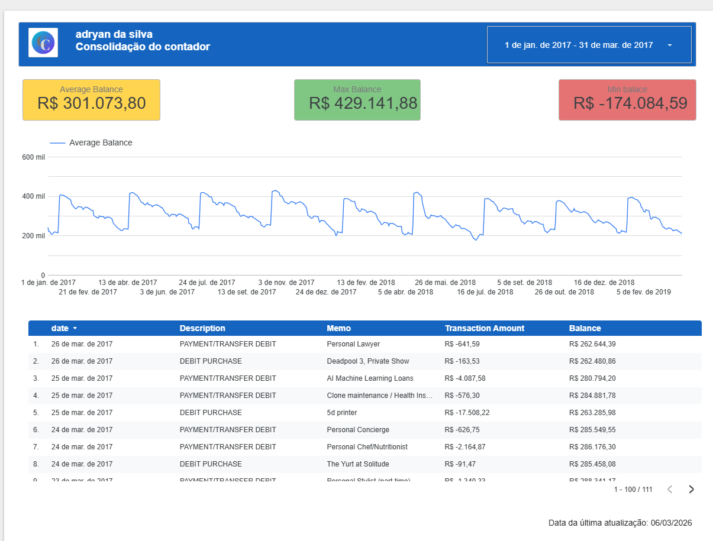
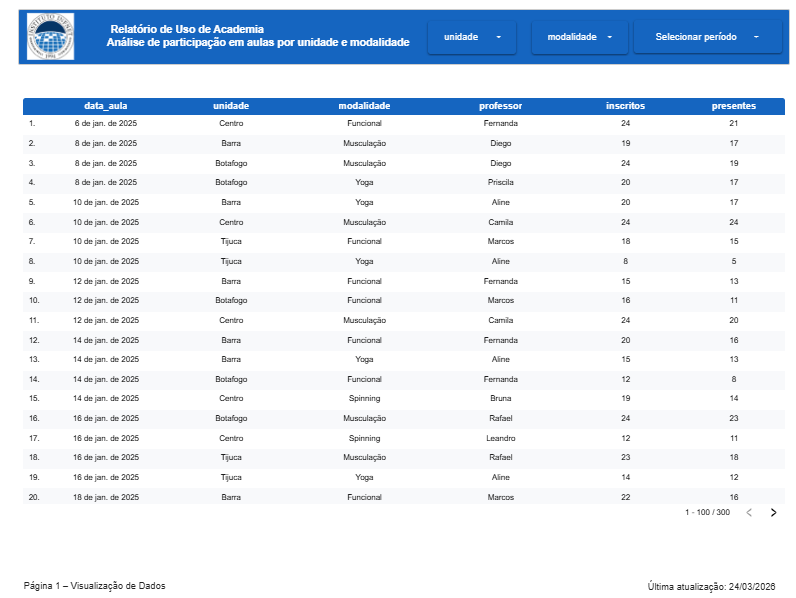
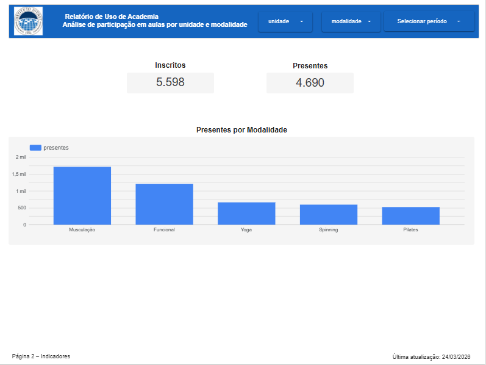
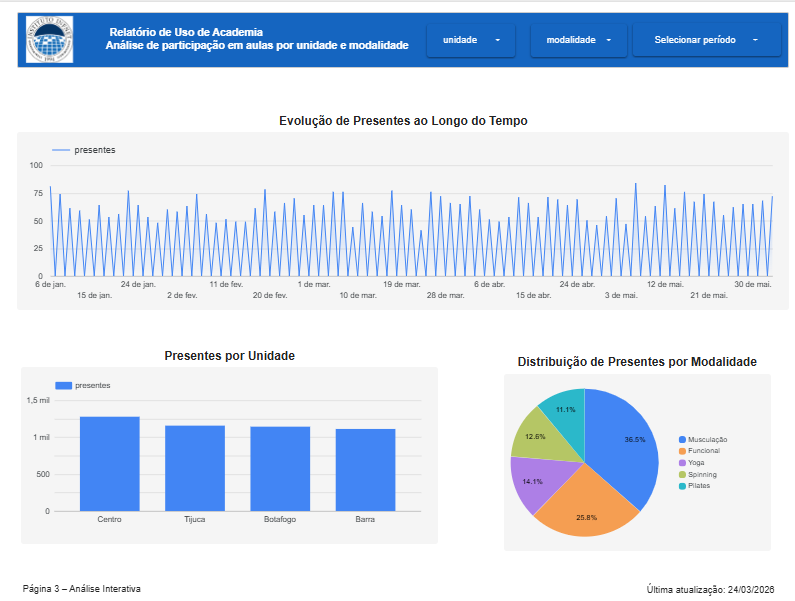
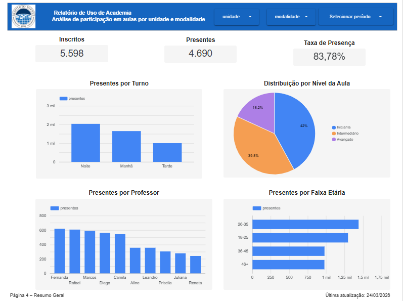

# 📊 Introdução à Visualização de Dados e SQL

Disciplina 1 do bloco **Fundamentos do Processamento de Dados** — graduação em ADS Full Stack e Automação, Instituto Infnet (1º semestre de 2026).

**Ferramentas:** Google Looker Studio · Google Sheets · SQL (ANSI) · Deepnote

**Resultado:** ✅ Aprovado — **todas as competências demonstradas com o conceito máximo (DML)**

---

## 🎯 Competências

| # | Competência | Conceito |
|---|-------------|:--------:|
| 1 | Visualizar dados de um CSV no Google Looker Studio | DML |
| 2 | Construir um relatório interativo baseado em dados usando Google Looker Studio | DML |
| 3 | Realizar queries SELECT em uma base de dados SQL | DML |
| 4 | Extrair informações através de agrupamentos e sumarização (GROUP BY e ORDER BY) | DML |

## 📋 Entregas

| Atividade | Tema | Rubrica | Entrega |
|-----------|------|:-------:|---------|
| TP1 | CSV no Looker Studio + limpeza de dados e dashboard | 12/12 itens ✅ | 2 dias adiantado |
| TP2 | Relatório interativo com scorecards, série temporal e filtros | 100% ✅ | 4h adiantado |
| TP3 | Consultas SELECT com filtros lógicos e relacionais | 100% ✅ | 1 dia adiantado |
| Assessment | Relatório completo no Looker Studio + 12 consultas SQL | 100% nas 4 competências ✅ | 4 dias adiantado |

---

## TP1 — Visualizar dados de um CSV no Looker Studio

**Parte 1 — Primeiro relatório:** conexão de um CSV pelo conector de upload de arquivo e visualização em tabela.
🔗 [Ver relatório](https://lookerstudio.google.com/reporting/8db8452d-0259-4e66-bdc4-3f710f9543ef)

**Parte 2 — Dashboard de uma cafeteria:** importei a planilha para o Google Sheets e fiz a limpeza dos dados antes de conectar ao Looker Studio:
- normalização para formato tabular
- um único tipo de dado por coluna
- tratamento de células vazias
- padronização das datas em `DD/MM/AAAA`

O dashboard tem tabela, scorecard de itens vendidos e gráficos de pizza por produto e por tipo de produto.
🔗 [Ver dashboard](https://lookerstudio.google.com/reporting/6b8166fb-586f-47be-a07d-52d8f1a4e161)

**Análise:** foram vendidos 14.123 itens no período. Um único produto (Lunch Bun) responde por mais de 70% das vendas e, por tipo, os cupcakes passam de 80%, o que mostra uma demanda forte por itens rápidos e individuais. Houve um pico de vendas em um dia específico, possivelmente ligado a promoção ou maior movimento, e alguns bolos venderam pouco, o que indica a necessidade de divulgação ou revisão do cardápio.

---

## TP2 — Relatório interativo: "Consolidação do contador"

Relatório financeiro montado a partir de uma planilha no Google Sheets:
- cabeçalho personalizado com logo
- scorecards de saldo médio, máximo e mínimo
- série temporal do saldo médio
- tabela de transações
- controle de período e rodapé com data da última atualização

🔗 [Ver relatório](https://lookerstudio.google.com/reporting/41c815a4-0b4f-4e57-bb27-34e925e483ca)

---

## TP3 — Consultas SELECT

16 consultas em uma base de loja (produtos, clientes, pedidos e vendedores), praticando:
- seleção de colunas
- filtros com `=`, `!=`, `<`, `>`, `<=` e `>=`
- combinação de condições com `AND`/`OR`
- listas de valores com `IN`

Feito no Deepnote. 🔗 [Ver notebook](https://deepnote.com/workspace/infnet-f16a-7b5bd4e4-8387-4b5e-b8b7-845a9c889146/project/Teste-de-Performance-3-Duplicate-4dad5fe5-ec48-415c-8a44-f3c01c7c4e94/notebook/Teste-de-Performance-3-9b1d4a5df88e47ec839946e612d4520a)

---

## Assessment — Relatório de academia + SQL

### Parte 1 — Relatório "Uso de Academia" (Looker Studio)

Relatório de 4 páginas com identidade visual única, a partir de um CSV de aulas de academia:

| Página | Conteúdo |
|--------|----------|
| 1 | Base conectada (Sheets → Looker Studio) em tabela |
| 2 | Scorecards de inscritos e presentes + presentes por modalidade |
| 3 | Análise por unidade, modalidade e evolução no tempo, com filtros e controle de período |
| 4 | Resumo geral para apresentação: taxa de presença, presentes por turno, professor, nível e faixa etária |

🔗 [Ver relatório completo](https://lookerstudio.google.com/reporting/4fc4189c-cd35-4741-a054-38179b11b7e4)

| Página 1 | Página 2 |
|---|---|
|  |  |
| **Página 3** | **Página 4** |
|  |  |

### Parte 2 — SQL

12 consultas em três bases (filmes, funcionários e produtos de mercado), usando:
- filtros, `IN`, `DISTINCT`
- `ORDER BY` com mais de uma coluna
- `GROUP BY` com `COUNT`, `AVG`, `SUM`, `MIN`, `MAX` e `HAVING`

📄 [Ver todas as consultas](sql/assessment.sql)
