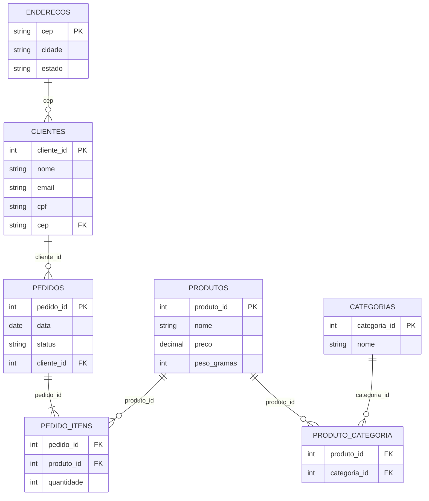

# TP2 — Normalização de uma loja virtual de artesanato

Ponto de partida: a planilha `pedidos_artesanato.csv`, com uma linha por item de pedido. O SQL das etapas de implementação está em [tp2-normalizacao-loja.sql](tp2-normalizacao-loja.sql).

## Ex. 1 — Entidades principais

As três entidades principais identificadas na tabela são Produto, Cliente e Pedido. A entidade Produto representa os itens vendidos pela loja, como "Vaso de cerâmica", "Bolsa de palha" e "Quadro de macramê", permitindo identificar quais produtos possuem maior saída e quais são mais vendidos. A entidade Cliente representa as pessoas que realizam compras na loja, armazenando informações como nome, e-mail, CPF, cidade e estado, o que possibilita identificar quem está efetuando cada compra. Já a entidade Pedido representa a relação entre o cliente e os produtos comprados, contendo informações como número do pedido, data, quantidade e status da entrega. Essa entidade é importante para controlar as vendas realizadas e acompanhar o andamento dos pedidos da loja.

## Ex. 2 — Violação da 1FN

A coluna que viola a Primeira Forma Normal (1FN) é a coluna `categorias`, pois ela armazena mais de um valor na mesma célula, como "decoração, artesanato" e "moda, acessórios, bijuteria". Isso viola a regra da 1FN, que determina que cada campo da tabela deve conter apenas um valor único e indivisível. Esse problema pode dificultar consultas e filtros no sistema da loja, já que buscar produtos de uma categoria específica exigiria procurar palavras dentro de textos misturados, aumentando as chances de inconsistências e erros. Para resolver essa situação, as categorias deveriam ser reorganizadas em tabelas separadas, criando uma tabela própria para categorias e outra tabela intermediária relacionando produtos e categorias, permitindo que cada categoria fique registrada individualmente.

## Ex. 3 — Violação da 2FN

A Segunda Forma Normal (2FN) estabelece que, em tabelas com chave primária composta, todos os atributos não-chave devem depender da chave inteira, e não apenas de parte dela. Na tabela apresentada, considerando que a chave é formada por `pedido_id` e `produto_nome`, os atributos `categorias`, `preco` e `peso_gramas` dependem apenas do produto, e não do pedido completo. Isso caracteriza uma violação da 2FN, pois essas informações estão sendo repetidas em diferentes pedidos do mesmo produto. Na prática, isso pode causar redundância e inconsistência nos dados. Por exemplo, se o preço do "Vaso de cerâmica" precisar ser alterado, será necessário atualizar todas as linhas onde ele aparece, aumentando o risco de alguns registros ficarem com valores diferentes. Para resolver esse problema, as informações dos produtos deveriam ser separadas em uma tabela própria de produtos, enquanto a tabela de pedidos armazenaria apenas os dados relacionados à compra realizada.

## Ex. 4 — Violação da 3FN

A Terceira Forma Normal (3FN) estabelece que nenhum atributo não-chave pode depender de outro atributo não-chave. Na tabela apresentada, existe uma dependência transitiva entre as colunas `cliente_cpf`, `cep`, `cidade_cliente` e `estado_cliente`. O CPF identifica o cliente, o cliente possui um CEP, e esse CEP determina a cidade e o estado do cliente. Dessa forma, cidade e estado não dependem diretamente da chave principal do cliente, mas sim do CEP, caracterizando uma violação da 3FN. Na prática, isso pode causar inconsistências no sistema. Por exemplo, se um CEP for reclassificado para outro município ou estado, será necessário atualizar várias linhas manualmente, aumentando o risco de alguns registros permanecerem com informações desatualizadas. Para resolver esse problema, os dados de localização deveriam ser separados em uma tabela própria de endereços, deixando a tabela de clientes responsável apenas pelas informações diretamente relacionadas ao cliente.

## Ex. 5 — Modelo proposto

- **PRODUTOS:** separa as informações próprias de cada produto (preço, peso), eliminando a repetição desses dados em vários pedidos e corrigindo a violação da 2FN.
- **CLIENTES:** armazena apenas os dados do cliente, sem misturar informações de pedido ou localização.
- **ENDERECOS:** isola CEP, cidade e estado numa tabela própria, quebrando a dependência transitiva cliente → cep → cidade/estado e corrigindo a violação da 3FN.
- **PEDIDOS:** registra o evento de compra com data e status, ligado ao cliente pelo `cliente_id` (FK).
- **PEDIDO_ITENS:** tabela intermediária com chave composta (`pedido_id` + `produto_id`) que resolve o relacionamento N:N entre pedidos e produtos, registrando a quantidade de cada item.
- **CATEGORIAS:** armazena cada categoria individualmente como um registro próprio.
- **PRODUTO_CATEGORIA:** tabela intermediária que resolve o relacionamento N:N entre produtos e categorias, corrigindo a violação da 1FN (múltiplas categorias numa célula só).

## Ex. 16 — Análise de uma proposta alternativa de avaliações

- **1FN:** a tabela proposta viola a 1FN, pois a coluna `categorias` possui mais de um valor na mesma célula, como "decoração, artesanato" e "moda, acessórios". Para corrigir, as categorias devem ser separadas em uma tabela própria e relacionadas aos produtos por uma tabela intermediária.
- **2FN:** a tabela também viola a 2FN, porque dados como `produto_nome` e `categorias` dependem do produto, e não da avaliação inteira. Para corrigir, os dados do produto devem ficar separados.
- **3FN:** a tabela também viola a 3FN, pois `cliente_email` depende de `cliente_nome` ou do cliente, e não diretamente da avaliação. Isso causa repetição dos dados do cliente. Para corrigir, os clientes devem ficar em uma tabela separada.

A tabela correta de avaliações ficaria apenas com os dados próprios da avaliação e as chaves estrangeiras (o SQL está no fim de [tp2-normalizacao-loja.sql](tp2-normalizacao-loja.sql)).
